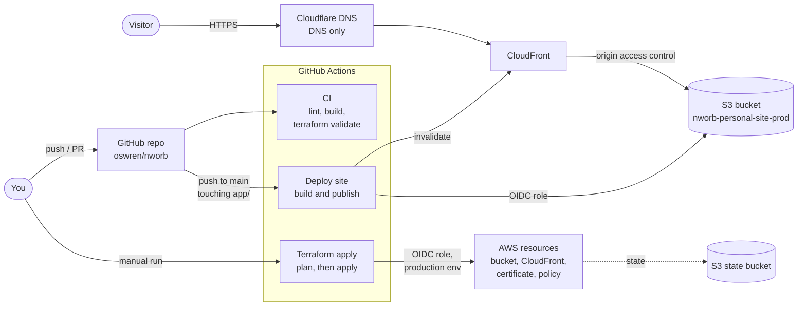
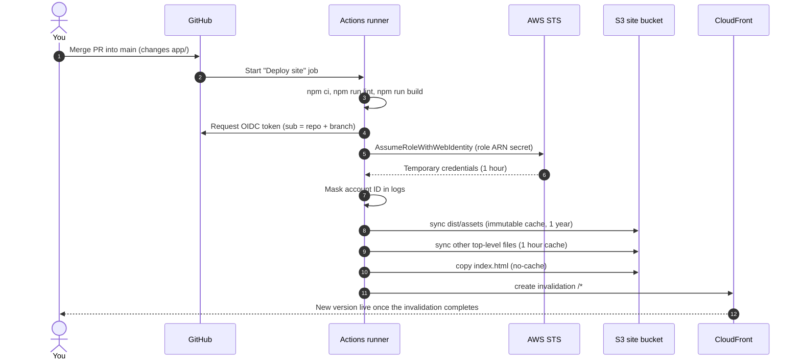
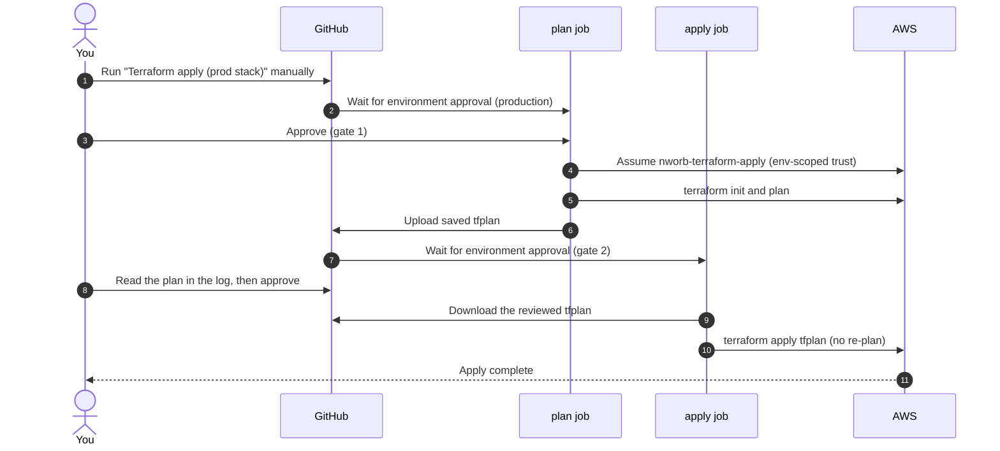
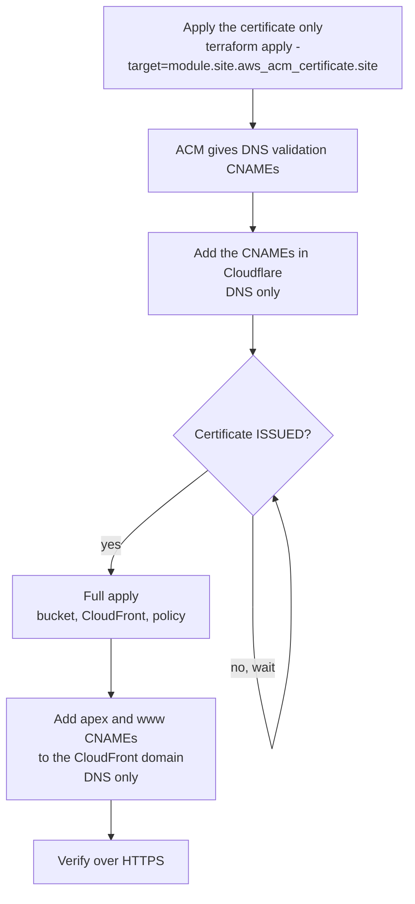
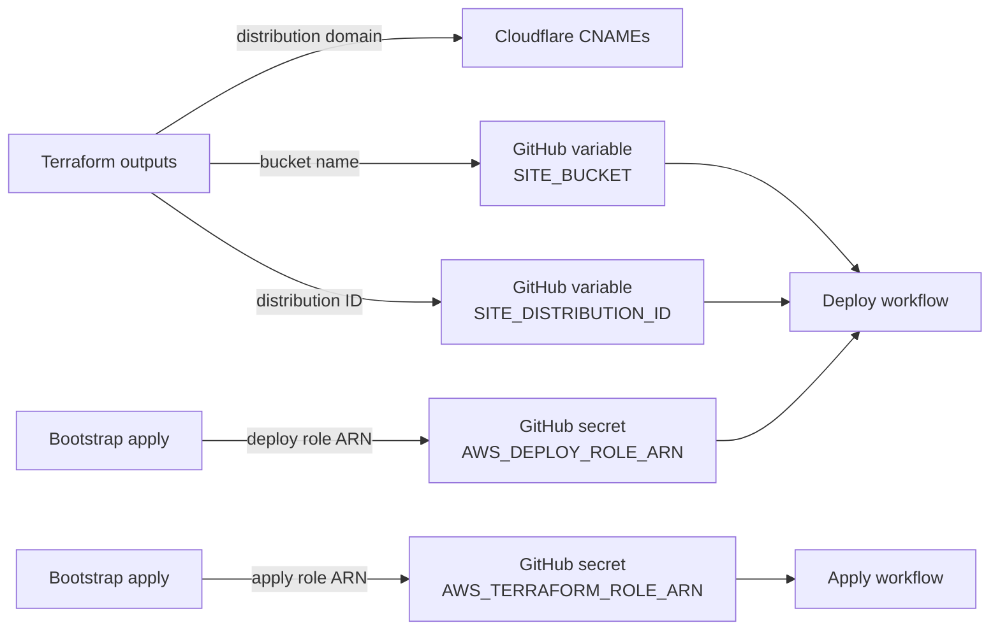

# How nworb.cloud is built and deployed

This explains how the personal site gets from source code to `https://nworb.cloud`. It covers two separate flows:

1. **Content and code changes**: the React app is built and published by GitHub Actions.
2. **Infrastructure changes**: the AWS resources are managed by Terraform, applied through a gated workflow.

The two are connected by a few values (bucket name, distribution ID, role ARNs) that Terraform creates and GitHub stores.

---

## 1. The big picture



- **Visitors** resolve `nworb.cloud` in Cloudflare. The records are DNS-only, so traffic goes straight to CloudFront.
- **CloudFront** serves the files from the private S3 bucket over HTTPS.
- **Deploys** copy the built app into the bucket and clear CloudFront's cache.
- **Terraform** creates and changes the AWS resources. It doesn't touch the site files.

---

## 2. Who owns what

| Concern | Owned by | Where |
|---|---|---|
| Site code | You, via PRs | `app/` |
| Building the site | GitHub Actions | `.github/workflows/deploy.yml` |
| Publishing the site | GitHub Actions, through the deploy role | `deploy.yml` and `infra/bootstrap/github-oidc.tf` |
| AWS resources (bucket, CloudFront, certificate, policy) | Terraform | `infra/modules/static-site`, `infra/envs/prod` |
| Terraform state | S3 state bucket | `nworb-terraform-state-eu-west-2`, key `site/prod/terraform.tfstate` |
| Role for Terraform apply | Terraform (bootstrap) | `infra/bootstrap/github-terraform.tf` |
| DNS records | Cloudflare, by hand or with `cf` | `nworb.cloud` zone |

The bootstrap stack (`infra/bootstrap`) is applied by hand, on purpose. It owns the roles that CI assumes, so CI must not be able to change its own trust.

---

## 3. Flow A: publishing a site change

Triggered by a push to `main` that changes anything under `app/`, or by a manual run.



### Step by step

1. **Make the change.** Work on a branch, open a PR, and let the `CI` workflow check it. It runs `npm run lint`, `npm run build`, and Terraform `fmt` and `validate`.
2. **Merge the PR into `main`.** Branch protection requires the two CI checks to pass and the PR to be approved.
3. **The `Deploy site` workflow starts.** The `concurrency` group means only one deploy runs at a time. A running deploy is never cancelled.
4. **Build.** `npm ci`, then lint, then `npm run build`. The output goes to `app/dist/`.
5. **Authenticate.** The job asks GitHub for an OIDC token and exchanges it for AWS credentials with `nworb-github-deploy`. No keys are stored. The trust policy only accepts `main` in `oswren/nworb`.
6. **Hide the account ID.** The next step adds the account ID to GitHub's log masks.
7. **Publish in order:**
   - `dist/assets/*` with `max-age=31536000, immutable`. The filenames are hashed, so they can be cached for a year.
   - Other top-level files with `max-age=3600`.
   - `index.html` with `no-cache`, so visitors always get the newest entry point.
   - The `--delete` flag on the assets sync removes old hashed files.
8. **Invalidate CloudFront** for `/*`, so the edge stops serving the old `index.html`.

### Checking a deploy

```bash
gh run list --repo oswren/nworb --workflow "Deploy site" --limit 3
curl -sS -o /dev/null -w "%{http_code}\n" https://nworb.cloud/
```

---

## 4. Flow B: changing infrastructure

This is for changes to Terraform: the bucket, CloudFront, the certificate, or the bucket policy. It runs in two gates, so you review the plan before anything is applied.



Both jobs run in the `production` environment, and that environment's trust policy is the only way the apply role can be assumed. The apply uses the saved plan, so nothing can change between review and apply.

### Step by step

1. **Change the Terraform** on a branch, and open a PR. CI validates it.
2. **Merge the PR.**
3. **Run the workflow.** GitHub Actions → `Terraform apply (prod stack)` → Run workflow, on `main`.
4. **Gate 1: approve the plan job.** The plan runs with no changes made.
5. **Read the plan.** Open the plan job's log. Look for `Plan: N to add, N to change, N to destroy`, and check anything that says `destroy` or `replace`.
6. **Gate 2: approve the apply job.** Only do this once the plan looks right.
7. **Check the result.** The apply job reports what it changed. Run `terraform plan` locally to confirm there's no drift.

Run `terraform plan` by hand with `AWS_PROFILE` set, for example to check a change before opening the PR:

```bash
cd infra/envs/prod
AWS_PROFILE=admin-nworb terraform init -input=false
AWS_PROFILE=admin-nworb terraform plan -input=false
```

---

## 5. Creating the certificate and the site (first time only)

Certificates have to be validated through DNS before CloudFront can use them. That's why the first apply runs in two steps.



Why two steps: the validation resource waits for ACM to see the DNS record. If the record doesn't exist yet, a single apply hangs until it times out.

### Step by step

1. **Create the certificate.** Run the targeted apply from the prod stack. This creates only the certificate.
2. **Get the validation records.** `terraform output certificate_validation_records`.
3. **Add them in Cloudflare.** Create each CNAME with **DNS only**. Cloudflare adds the zone name for you, so enter the name without the domain.
4. **Wait for ISSUED.** ACM polls on its own schedule. Check with `aws acm describe-certificate --region us-east-1`.
5. **Run the full apply.**
6. **Point the domain at CloudFront.** Add the apex and `www` CNAMEs to the distribution's domain name. Use DNS only, and don't proxy them.

### Pitfall to avoid

Don't wrap a long Terraform apply in `timeout`. A timeout killed Terraform during a CloudFront create once. The distribution existed in AWS but not in state, and it had to be imported. If you need to stop an apply, let Terraform finish the in-flight operation.

---

## 6. Where the values come from and go to



| Value | Type | Why it's stored that way |
|---|---|---|
| `AWS_DEPLOY_ROLE_ARN`, `AWS_TERRAFORM_ROLE_ARN` | Secret | GitHub masks secrets in logs. The ARNs contain the account ID. |
| `SITE_BUCKET`, `SITE_DISTRIBUTION_ID` | Variable | Identifiers, not credentials. |
| Account ID | Never committed | Masked in logs with `::add-mask::`. |

If you ever recreate the distribution, its ID changes. Update `SITE_DISTRIBUTION_ID` before the next deploy, or the invalidation will fail.

---

## 7. Troubleshooting

| Symptom | Likely cause | What to do |
|---|---|---|
| Deploy fails at "Assume deploy role" | Trust policy doesn't match the OIDC subject | Check `gh api repos/oswren/nworb/actions/oidc/customization/sub`. This repo uses immutable subjects. |
| Deploy succeeds but the old page shows | The `index.html` cache, or the invalidation hasn't finished | Wait a minute, then hard-refresh. Check the invalidation's status. |
| Terraform apply hangs on `aws_acm_certificate_validation` | DNS record missing or wrong | Check the validation CNAME is DNS only and matches the output exactly. |
| HSTS error in the browser | The domain points at a host with a certificate that doesn't match | Point the domain at CloudFront. Browsers that have seen HSTS can't click through a bad certificate. |
| `terraform plan` shows changes after a manual edit | Drift in AWS | Decide whether to keep the AWS change (update the code) or revert it (apply). |
| Terraform shows a resource in AWS but not in state | An interrupted apply | Import it with `terraform import`, then plan again. |

---

## 8. Quick reference

| Task | Command or action |
|---|---|
| Check a site | `curl -sS -o /dev/null -w "%{http_code}\n" https://nworb.cloud/` |
| List deploy runs | `gh run list --repo oswren/nworb --workflow "Deploy site"` |
| Plan infra locally | `AWS_PROFILE=admin-nworb terraform plan` in `infra/envs/prod` |
| Apply infra | Actions → `Terraform apply (prod stack)` → approve twice |
| Check the certificate | `aws acm describe-certificate --region us-east-1 --certificate-arn <arn>` |
| Force a cache refresh | `aws cloudfront create-invalidation --distribution-id <id> --paths "/*"` |
